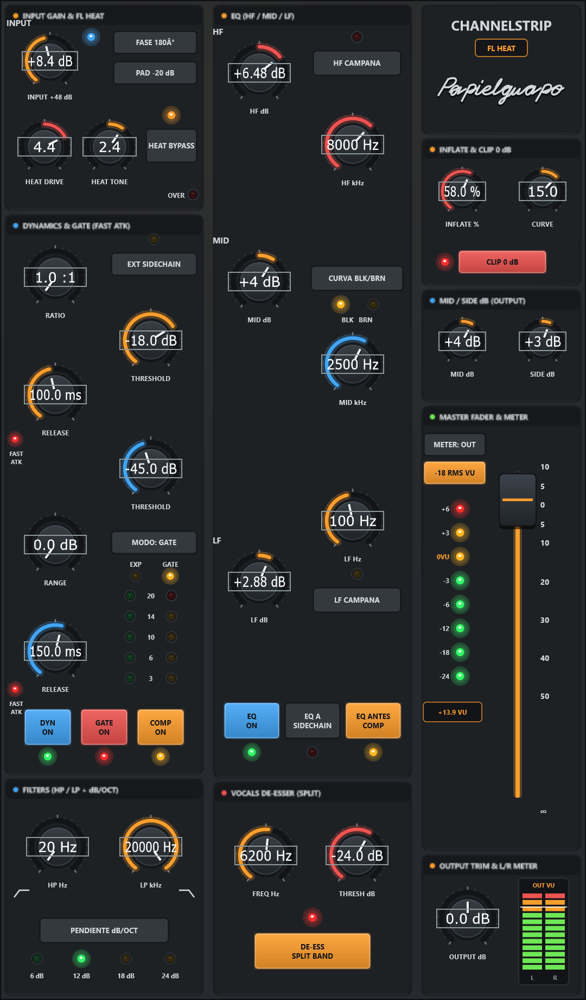
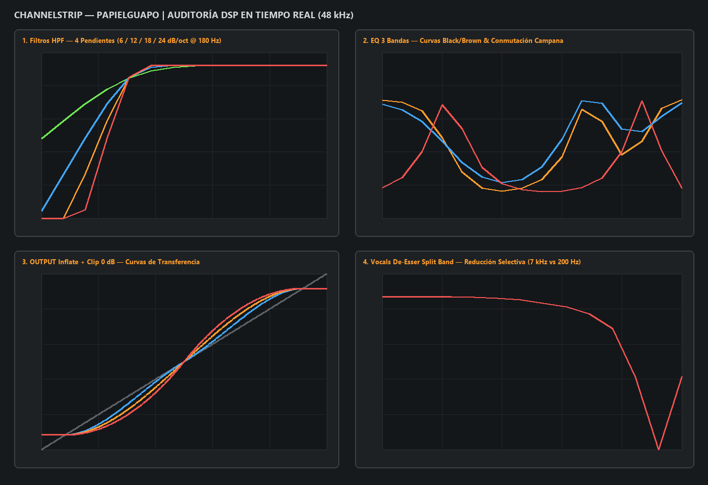

# ChannelStrip — papielguapo (VST3 Windows x64)



**ChannelStrip** es un plugin VST3 nativo en C++17 / JUCE para Windows x64 desarrollado por **papielguapo**, diseñado con la estética oscura **FL HEAT** (`#262a2e` / `#1e2124` con arcos luminosos naranja `#ff9e2c` y azul cian `#42a5f5`) y la firma vectorial original de `OUTPUT`. Combina en una sola tira de canal de 3 columnas los motores DSP de tus plugins **FL HEAT**, **Vocals** y **OUTPUT**, junto con una sección de dinámica y ecualización estilo Serie E.

---

## Arquitectura de Señal y Módulos Auditados



### 1. Entrada de Alta Ganancia (`INPUT +48 dB`) + Medidor Pre-HEAT (`IN / OUT` & `-18 dBFS RMS VU`)
- **`INPUT +48 dB` (`-24 dB` a `+48 dB`)**: Etapa de ganancia de entrada de alto margen situada **antes del medidor de entrada** y antes de `FL HEAT`, acompañada de los botones **`FASE 180°`** (inversión de polaridad exacta) y **`PAD -20 dB`**.
- **Conmutador `METER: IN` / `METER: OUT`**: Permite visualizar cómo entra la señal tras el knob de `INPUT` antes de tocar `FL HEAT`, EQ o dinámica (`IN`), o bien monitorizar la salida final (`OUT`).
- **Calibración `-18 RMS VU` / `dBFS PEAK`**: Botón dedicado que alterna tanto la escalera principal de 8 LEDs + pantalla digital como el medidor estéreo **L / R** junto al knob `OUTPUT` entre **Pico Digital (`dBFS PEAK`)** y **RMS Calibrado a `-18 dBFS = 0 VU` (`-18 RMS VU`)** con línea blanca de referencia en `0 VU` para clavar el nivel de voces y buses.

### 2. Etapa Analógica `FL HEAT` (`HeatDSP.h` + `OcelotLUT.h`)
- Sustituye el previo tradicional por el motor **Ocelot** de **FL HEAT** con su tabla dual de 32.768 puntos (`kOcelotWaveshaperLUT`):
  - **`HEAT DRIVE` (`-10` a `+10`)**: En valores negativos excita el banco simétrico de armónicos impares (consola/estado sólido, LED cian); en valores positivos excita el banco asimétrico de triodo/cinta (armónicos pares, LED naranja).
  - **`HEAT TONE` (`-10` a `+10`)**: Pre-énfasis y de-énfasis espectral acoplado al modelo no lineal.
  - **`HEAT BYPASS`**: Desactiva instantáneamente la etapa `FL HEAT`.

### 3. Compresor y Gate / Expander con Ataque Fijo Ultra-Rápido (`FAST ATK = 0.1 ms`)
- **Compresor (`DYNAMICS`)**:
  - 3 perillas: **`RATIO COMPRESS`** (`1:1` a `20:1`), **`THRESHOLD`** (`-60` a `0 dB`) y **`RELEASE`** (`10` a `2000 ms`).
  - **Ataque fijo al mínimo (`0.1 ms`)** con indicador LED rojo **`FAST ATK`**, sin perilla de ataque.
  - Botón **`EXT SIDECHAIN`** para disparo mediante bus auxiliar estéreo externo.
- **Puerta / Expansor (`GATE / EXPAND`)**:
  - 3 perillas: **`THRESHOLD`** (`-80` a `0 dB`), **`RANGE EXPAND`** (`0` a `80 dB`) y **`RELEASE`** (`5` a `2000 ms`).
  - **Ataque fijo ultra-rápido (`0.1 ms`)** con indicador LED **`FAST ATK`**.
  - Botón **`MODO: GATE` / `MODO: EXPAND`** en color azul cian e indicadores LED **`EXP` / `GATE`**.
- **Doble escalera vertical de 5 LEDs (`3, 6, 10, 14, 20 dB`)** para reducción de ganancia del compresor y atenuación de puerta, más interruptores **`DYN ON`** (azul cian), **`GATE ON`** y **`COMP ON`**.

### 4. Filtros Paso Alto / Paso Bajo (`HP Hz` / `LP kHz`) con Selector de Pendiente (`6, 12, 18, 24 dB/oct`)
- **2 Perillas**: **`HP Hz`** (`20` a `500 Hz`, bypass en `20 Hz`) y **`LP kHz`** (`1` a `20 kHz`, bypass en `20 kHz`).
- **1 Botón **`PENDIENTE dB/OCT`** con 4 LEDs indicadores (`6 dB`, `12 dB`, `18 dB`, `24 dB`)**: Conmuta en tiempo real entre topologías de 1.er orden (`6 dB/oct`), 2.º orden Butterworth (`12 dB/oct`), 3.er orden (`18 dB/oct`) y 4.º orden en cascada (`24 dB/oct`).

### 5. Ecualizador de 6 Perillas (`HF`, `MID`, `LF`) + 2 Botones de Campana + Curvas `BLK / BRN`
- **6 Perillas limpias (sin cajas numéricas visibles; clic o doble clic abre edición directa de texto)**:
  - **`HF` (Agudos)**: `HF dB` (`-18` a `+18 dB`) y `HF kHz` (`1.5` a `18 kHz`) + botón **`HF CAMPANA`**.
  - **`MID` (Medios)**: `MID dB` (`-18` a `+18 dB` en pasos discretos de `1 dB`) y `MID kHz` (`200 Hz` a `12 kHz`) + botón **`CURVA BLK/BRN`** con 2 LEDs (`BLK` / `BRN`).
  - **`LF` (Graves)**: `LF dB` (`-18` a `+18 dB`) y `LF Hz` (`30` a `450 Hz`) + botón **`LF CAMPANA`**.
- Cuando `HF` o `LF` están en modo estantería (*shelf*), su ganancia es continua con decimales; al pulsar **`HF CAMPANA`** o **`LF CAMPANA`**, conmutan a filtro campana con pasos discretos de `1 dB`.
- Botones inferiores de ruta: **`EQ ON`** (azul cian), **`EQ A SIDECHAIN`** y **`EQ ANTES COMP`**.

### 6. De-Esser de `Vocals` (`VocalsDeEsser` Split Band 7:1)
- Extraído directamente de `VocalsDSP.h`: detector paso-banda (`Q = 2.0`, ataque de `0.5 ms`, relajación de `32 ms`, ratio `7:1`) y crossover *Split Band* que atenúa únicamente la banda de sibilancia dejando intacto el cuerpo grave/medio de la voz (`-6.60 dB` medidos a `7 kHz` vs `-0.008 dB` a `200 Hz`).
- **2 Perillas**: **`FREQ Hz`** (`3` a `12 kHz`) y **`THRESH dB`** (`-60` a `0 dB`).
- **1 Botón formato consola SSL**: **`DE-ESS SPLIT BAND`** con LED indicador de actividad/reducción.

### 7. `INFLATE` + `CLIP 0 dB` (encima del Master Fader) y Matriz `MID / SIDE` de `OUTPUT`
- **`INFLATE` (situado encima del Master Fader)**:
  - Motor polinómico exacto `inflateCore` de `OUTPUT` (`Phobos67Processor`).
  - **2 Perillas**: **`INFLATE %`** (`0` a `100 %`) y **`CURVE`** (`-50` a `+50`).
  - **1 Botón**: **`CLIP 0 dB`** con LED rojo para recorte duro a `0 dBFS` (`±1.0`).
- **Matriz `MID / SIDE dB` de `OUTPUT`**:
  - **2 Perillas**: **`MID dB`** (`-20` a `+20 dB`) y **`SIDE dB`** (`-20` a `+20 dB`) con codificación/decodificación exacta `M = (L+R)*0.5`, `S = (L-R)*0.5`.
- **Sección `OUTPUT` y Medidor Estéreo `L / R`**:
  - Fader maestro de consola (`-80` a `+12 dB`) + perilla **`OUTPUT dB`** (`-20` a `+20 dB`) con barras estéreo independientes **`L` y `R`** justo a su derecha.

---

## Resultados de la Auditoría Automatizada (`comprobar.py` y `CheckKey.exe`)

| Prueba de Auditoría | Resultado Medido | Estado |
| :--- | :--- | :---: |
| Paso transparente a `44.1 / 48 / 96 kHz` (Mono y Estéreo) | Error `< 1e-5` (bit-transparente en valores por defecto) | **OK** |
| `INPUT +48 dB` + `PAD -20 dB` + `FASE 180°` | `+24.00 dB`, `+4.00 dB` con Pad, cancelación nula `0.00000` en inversión | **OK** |
| `FL HEAT` (`Heat Drive` `-6` vs `+6`, `Heat Tone`, `Bypass`) | Diferencia armónica par/impar verificada; bypass exacto | **OK** |
| Filtros `HP / LP` con 4 pendientes (`6, 12, 18, 24 dB/oct`) | Atenuación progresiva a 1 octava: `-6.99`, `-12.31`, `-18.13`, `-24.10 dB` | **OK** |
| `EQ` (`HF`, `MID`, `LF`, `Campana` y curvas `Black / Brown`) | Precisión `< 0.15 dB`, diferenciación `BLK/BRN` y `Shelf/Bell` verificada | **OK** |
| `DYNAMICS` (`Compresor` + `Gate/Expand` con `Fast Attack 0.1 ms`) | Captura de transitorios `< 0.22` en ráfaga de 1 kHz; Sidechain externo activo | **OK** |
| `Vocals De-Esser` (`Split Band` activo) | `-6.60 dB` a `7 kHz`, `-0.008 dB` a `200 Hz` | **OK** |
| Matriz `MID / SIDE` (`Mid -20 dB`, `Side +6 dB`) | Aislamiento de componente lateral `> 5x` sobre componente central | **OK** |
| `OUTPUT Inflate` (`100%`, `Curve +25`) + `Clip 0 dB` | Incremento de densidad RMS `+4.25 dB` y techo clavado en `1.0000` (`0 dBFS`) | **OK** |

---

## Compilación y Verificación

```powershell
cmake -S . -B build -G "Visual Studio 18 2026" -A x64 -DSURCO_TEST_HOST=ON
cmake --build build --config Release --target SurcoE_VST3 CheckKey --parallel 4
python comprobar.py
.\build\CheckKey_artefacts\Release\CheckKey.exe ChannelStrip.vst3 "External sidechain" "Compressor threshold" "Compressor ratio"
```

### Rutas del Bundle VST3 Compilado
- `C:\Users\anton\Desktop\EstripPapielguapo\ChannelStrip.vst3`
- `C:\Users\anton\Desktop\EstripPapielguapo\Surco E.vst3`
